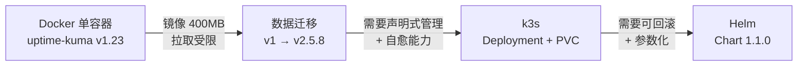
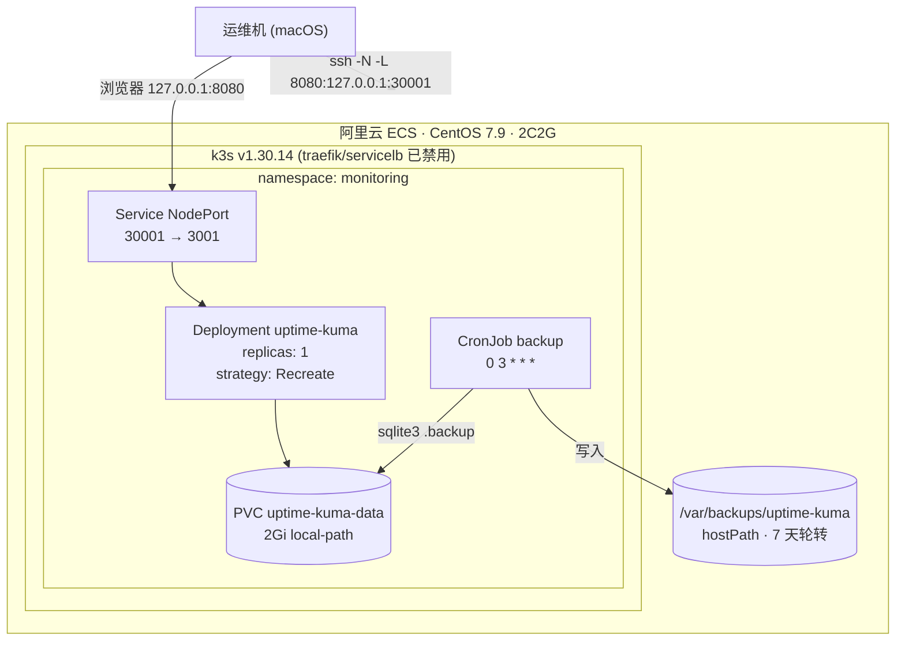

# k3s-uptime-kuma-ops

在一台 **2 核 2 GiB / 40 GiB** 的阿里云 ECS（CentOS 7.9）上，把 uptime-kuma 从 Docker 单容器演进到 **k3s + Helm** 的完整运维实践。

重点不是"服务跑起来了"，而是：**资源受限环境下每个技术选择为什么这么做、变更前怎么验证、出问题怎么定位到根因**。

所有命令都实际执行过，所有输出都是真实结果。踩坑记录见 [`docs/troubleshooting.md`](docs/troubleshooting.md)（1500 行）。

---

## 1. 环境约束

这张表决定了后面所有的设计取舍。

| 约束 | 实际情况 | 直接后果 |
|---|---|---|
| 内存 | 2 GiB，装完 k3s 后 available ≈ 780 MiB | 放弃完整 K8s，选 k3s；所有工作负载必须设 `limits` |
| cgroup | v1（`tmpfs`） | k3s 只能用 ≤ v1.30，v1.31+ 强制 cgroup v2 |
| 出网 | 无稳定国际带宽，公共代理实测 0.8 MB/s | 镜像走第三方代理；k3s 二进制走 gh-proxy；镜像 tag 必须固定，避免重建时重拉 |
| 系统 | CentOS 7.9，2024-06 已 EOL | yum 官方源失效，需切阿里云 vault 源 |
| 存储 | 40 GiB 单盘，无独立数据盘 | 只能用 `local-path`；备份与原件同盘（已知局限） |
| 入口 | 只有公网 IP，无域名 | NodePort + SSH 隧道，不向公网暴露服务端口 |

RAM 是这里最紧的资源。k3s 本身约占 500 MiB，留给应用的余量不到 800 MiB —— 这也是没有装 Ingress Controller、没有上 Prometheus 的原因。

## 2. 演进路径



每个阶段的触发原因都很具体：

| 阶段 | 触发问题 | 解决方式 |
|---|---|---|
| Docker → 迁移 | v1.23 版本过旧，官方要求升级 | 备份卷 → 停旧容器 → 同卷启动 2.x（详见第五部分） |
| Docker → k3s | 容器死了不会自愈；配置散落在 `docker run` 命令里，无法复现 | Deployment + 探针 + PVC |
| k3s → Helm | 两份 YAML 无版本、无参数、改动无从回退 | Chart + `helm rollback` |

## 3. 当前架构



组件清单：

| 组件 | 配置 | 说明 |
|---|---|---|
| 工作负载 | Deployment，1 副本，`Recreate` | RWO 卷不能滚动更新 |
| 服务 | NodePort 3001→30001 | 节点端口不对外开放，仅隧道访问 |
| 存储 | PVC 2 GiB，`local-path` | 数据与节点绑定 |
| 探针 | readiness 20s / liveness 90s | 首次启动需等 SQLite 迁移 |
| 资源 | requests 128Mi / limits 384Mi | 2C2G 机器上不能再高 |
| 备份 | CronJob 每日 03:00，7 天轮转 | `sqlite3 .backup` + `integrity_check` |
| 备份身份 | uid 1000，`runAsNonRoot`，drop ALL caps | 与 PVC 文件属主一致 |

## 4. 六个关键决策

### 4.1 `strategy: Recreate` 而不是 RollingUpdate

PVC 是 `ReadWriteOnce`，单节点只有一个 Pod 能挂载。滚动更新会先起新 Pod 再停旧 Pod，新 Pod 挂载卷时会被拒绝（`Multi-Attach error`），更新卡死。

`Recreate` 是**先停后起**，代价是几十秒中断，但这是单副本 + RWO 卷下唯一正确的选择。

### 4.2 备份用 `sqlite3 .backup` 而不是 `cp`

SQLite 在 WAL 模式下，数据分散在 `kuma.db` / `kuma.db-wal` / `kuma.db-shm` 三个文件。`cp kuma.db` 拿到的可能是「事务已提交到 WAL 但尚未 checkpoint 回主库」的中间态，恢复时直接损坏。

`.backup` 是 SQLite 官方在线备份命令，会在读锁保护下生成一致快照。代价是需要对卷**读写挂载** —— 只读挂载会因为无法创建 `-shm` 文件直接报 `readonly database`。

### 4.3 备份容器必须 `runAsUser: 1000`

镜像默认以 root 运行。如果备份 Job 以 root 打开 PVC 里的数据库，SQLite 创建/更新 `-wal`、`-shm` 文件时会把属主改成 root。等 Deployment 的 Pod（uid 1000）重启后再写库，就会拿到 `readonly database` 错误 —— 一个看起来完全无关的故障。

所以 `securityContext` 里 `runAsUser/runAsGroup/fsGroup` 全部锁定 1000，与 PVC 内原有文件属主一致。

### 4.4 `livenessProbe.initialDelaySeconds: 90`

v1.23 → v2.5.8 的跨版本迁移要跑 Aggregate Table 重建，实测启动耗时超过 60 秒。默认探针配置会在迁移中途把容器杀掉，导致迁移反复重启、永远跑不完。

90 秒是留出来的安全余量。这个参数是踩了坑之后加的，不是拍脑袋。

### 4.5 Helm 接管而不是重建

线上对象是 `kubectl apply` 创建的，集群里没有 Helm release 记录。删掉重建最省事，但会牵连 PVC —— 2 GiB 数据库有丢失风险。

做法是让 Chart 渲染出的对象与线上**一字不差**，再用 `helm install --take-ownership` 认领：

1. 对象名固定（`fullnameOverride`、PVC 名写死）
2. Pod 标签只用 `app: uptime-kuma`，与已有 selector 一致（selector 不可变）
3. 安全上下文、额外 env 默认关闭，image tag 保持原值

接管前用 `kubectl diff` 校验，确认只增加 metadata 标签。接管成功的判据不是 `STATUS: deployed`，而是 **Pod 名与 AGE 不变** —— 说明没有产生新 ReplicaSet。

### 4.6 镜像 tag 必须固定，且要本地补 tag

`louislam/uptime-kuma:2` 是浮动 tag。节点重启或镜像被 GC 后重拉，可能拿到未验证的新小版本，而 `values.yaml` 里写的还是 `2`，事后完全无法追溯。

但直接改成 `2.5.8` 会被 k3s 视为全新镜像，去外网拉 400 MB（0.8 MB/s → 8 分钟以上）。所以要先在本地给同一份镜像数据补一个精确名字：

```bash
k3s ctr -n k8s.io images tag \
  docker.io/louislam/uptime-kuma:2 \
  docker.io/louislam/uptime-kuma:2.5.8
```

两个 tag 的 digest 相同，共享同一份 blob，磁盘不翻倍。改完 values 再 upgrade，Pod 从本地缓存启动，20 秒 ready。

## 5. 踩坑索引

完整过程见 [`docs/troubleshooting.md`](docs/troubleshooting.md)。这里挑出最有代表性的十条：

| 现象 | 根因 | 位置 |
|---|---|---|
| `firewalld` 状态 `unknown` | unit 不存在 ≠ 未运行 | 一 · 1 |
| 改 SSH 端口后控制台连不上 | 阿里云 Workbench 固定探测 22 端口 | 一 · 4 |
| 安全组放行后仍超时 | 填的是阿里云内网代理地址，不是真实出口 IP | 一 · 6 |
| `docker pull` 超时 / ACR 返回 403 | 直连 Hub 不可达；ACR 加速器 2024-07 起仅服务白名单镜像 | 二 · 2、3 |
| 邮件通知 502 | `From` 与 SMTP 登录账号不一致 | 二 · 4 |
| k3s 卡在 `Downloading binary` | `INSTALL_K3S_MIRROR` 已废弃，实际仍走 GitHub | 五 · 1 |
| Pod 长时间 `ContainerCreating` | 400MB 镜像 + 0.8MB/s 代理，属正常耗时非故障 | 五 · 4 |
| v2 启动后不建库 | v2 新增 `db-config.json` setup 向导 | 五 · 6 |
| 宿主机 `sqlite3` 报 malformed schema | 3.7.17 不支持部分索引语法，需 ≥3.8 | 六 · 4 |
| `helm` 报 `localhost:8080` | k3s 的 kubectl 有额外回退路径，上游 helm 没有 | 七 · 1 |

## 6. 快速开始

```bash
# 全新部署（非接管场景）
helm install uptime-kuma ./charts/uptime-kuma-stack \
  -n monitoring --create-namespace

# 接管已存在的 kubectl 对象（需 Helm ≥ 3.17）
helm template uptime-kuma ./charts/uptime-kuma-stack -n monitoring | kubectl diff -f -
helm install uptime-kuma ./charts/uptime-kuma-stack -n monitoring --take-ownership
```

访问：

```bash
ssh -N -L 8080:127.0.0.1:30001 <your-server>
# 浏览器打开 http://127.0.0.1:8080
```

## 7. 目录结构

```
.
├── charts/uptime-kuma-stack/      # Helm Chart（1.1.0）
│   ├── values.yaml                # 全部可调参数
│   └── templates/                 # Deployment / Service / PVC / CronJob
├── scripts/
│   └── centos7-ecs-init.sh        # 系统初始化：yum 修复、chrony、swap、内核参数
├── docs/
│   ├── architecture.md            # 架构图与决策记录（ADR）
│   ├── runbook.md                 # 日常运维手册：备份、恢复、升级、回滚
│   ├── troubleshooting.md         # 1500 行排障记录（七部分 + 8 条可复用规则）
│   └── legacy/                    # 被 Chart 取代的裸 YAML，仅作历史参考
├── Makefile                       # 常用操作快捷方式
└── README.md
```

> `docs/legacy/` 里的文件**不要再用 `kubectl apply`**，会与 Helm 的状态冲突。

## 8. 已知局限

诚实记录，避免被当成"生产级方案"。

| 局限 | 影响 | 改进方向 |
|---|---|---|
| 备份与原件同盘 | 磁盘故障、误删、实例释放时同时丢失 | 推送到 OSS 做异地备份 |
| 单节点单副本 | 任何维护都是全量中断 | 多节点 + 副本 ≥2，或用 PDB 控制窗口 |
| `local-path` 存储 | 数据与节点绑定，Pod 无法漂移 | 改用 CSI 云盘 |
| 镜像依赖公共代理 | 代理失效则新 Pod 无法启动 | 私有仓库或 ACR 同步 |
| 主容器仍以 root 运行 | 容器逃逸风险面较大 | 已确认镜像支持 uid 1000，可迁至非 root（`value.podSecurityContext.enabled`） |
| 无 Ingress / TLS | 只能通过 SSH 隧道访问 | 接域名需启用 traefik（+50–80 MiB 内存） |

## 9. 一次真实的中断记录

从 `docker stop`（10-30 21:1x）到 k3s 内恢复（10-31 09:41），约 12 小时停机窗口 —— 这是跨版本数据迁移期间没有冗余实例导致的。uptime-kuma 自己的监控曲线如实记录了这段空白。

如果是生产环境，这个窗口需要能回答：中断起止时间、影响范围、MTTR、根因（迁移期间单点无冗余）。

---

**License**: MIT
