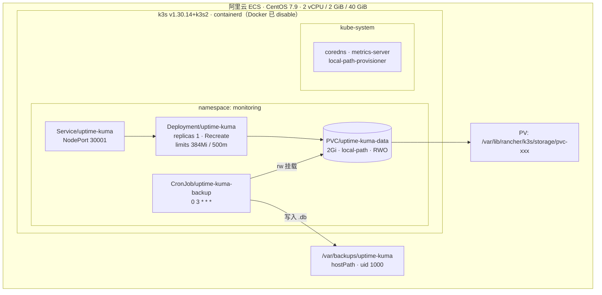

# 架构与决策记录

> 图中 Mermaid 语法在 GitHub、VS Code、Typora 中均可直接渲染。

## 1. 部署视图



## 2. 网络访问链路

公网不开放任何业务端口。完整链路是四段：

```
浏览器
  │  http://127.0.0.1:8080
  ▼
运维机本地端口（ssh -N -L 8080:127.0.0.1:30001）
  │  SSH over TCP 2222（ed25519 密钥，禁密码）
  ▼
服务器 127.0.0.1:30001（NodePort，仅回环可达）
  │  kube-proxy / iptables DNAT
  ▼
Service/uptime-kuma → Pod IP:3001
```

关键点：

- NodePort 监听 `0.0.0.0:30001`，但安全组**不放开 30001**，所以公网扫不到，只有隧道内可达。
- SSH 端口 2222 对 `0.0.0.0/0` 开放（家宽出口 IP 会变，白名单维护成本高），安全由「禁用密码 + 仅密钥」承担。
- 这条链路的代价是每次访问都要先建隧道，换来的是**零公网暴露面**。

## 3. 数据流

**写入路径**（正常运行时）：

```
Pod (uid 1000)
  └─ /app/data/
       ├─ kuma.db         主库
       ├─ kuma.db-wal     预写日志（未 checkpoint 的事务）
       └─ kuma.db-shm     共享内存索引
            ↕
        PVC → PV → /var/lib/rancher/k3s/storage/pvc-xxx_uptime-kuma-data
```

WAL 模式意味着**三个文件必须视为一个整体**。这解释了后面两条硬约束：备份不能用 `cp`，挂载不能只读。

**备份路径**（每日 03:00）：

```
CronJob → Pod (uid 1000, TZ=Asia/Shanghai)
  ├─ sqlite3 /app/data/kuma.db ".backup /backup/kuma-YYYYMMDD-HHMMSS.db"
  ├─ sqlite3 /backup/kuma-*.db "PRAGMA integrity_check"   → 非 ok 则删文件并失败
  ├─ find /backup -name 'kuma-*.db' -mtime +7 -delete      → 7 天轮转
  └─ 写入 hostPath /var/backups/uptime-kuma（目录需提前 chown 1000:1000）
```

## 4. 决策记录

### ADR-001 用 k3s 而不是 kubeadm

**背景**：2 GiB 内存，kubeadm 装完控制平面后可用内存不足 400 MiB。

**决策**：k3s，禁用 traefik 与 servicelb（`--disable`），单体进程约 500 MiB。

**后果**：牺牲多控制平面与部分插件生态，换来能跑得动的单节点集群。

**备选**：kubeadm + 单节点 —— 内存不够，未采用。

---

### ADR-002 版本锁定 v1.30 而不是最新版

**背景**：该 ECS 的文件系统为 `tmpfs` 类型（`stat -fc %T /sys/fs/cgroup` 返回 `tmpfs`），即 **cgroup v1**。

**决策**：装 `v1.30.14+k3s2`。v1.31 起 k3s 要求 cgroup v2，装上会直接起不来。

**后果**：版本落后一个大版本，无法使用 1.31+ 的特性。

**备选**：升级系统到 cgroup v2 —— 需要换内核与 init 参数，CentOS 7.9 上风险过高。

---

### ADR-003 `local-path` 而不是云盘 CSI

**背景**：无独立数据盘，40 GiB 系统盘。阿里云云盘 CSI 需要额外组件与 IAM 授权。

**决策**：k3s 自带的 `local-path-provisioner`，数据落在 `/var/lib/rancher/k3s/storage/`。

**后果**：Pod 与节点强绑定，无法漂移；节点故障即数据不可用。单节点场景下这个限制暂时不成立。

**备选**：云盘 CSI —— 内存与配置成本不划算，留作后续演进。

---

### ADR-004 `Recreate` 而不是 `RollingUpdate`

**背景**：PVC 为 `ReadWriteOnce`，单节点上同一时刻只能被一个 Pod 挂载。

**决策**：`strategy.type: Recreate`。

**后果**：每次更新有几十秒中断。`RollingUpdate` 会导致新 Pod 卡在 `Multi-Attach error`，更新永远不完成。

**备选**：`ReadWriteMany`（需要 NFS / CephFS）—— 单节点上属于过度设计。

---

### ADR-005 备份用 `.backup` 而非 `cp`

**背景**：SQLite 处于 WAL 模式，写入可能停留在 `-wal` 未落主库。

**决策**：`sqlite3 src ".backup dst"`，并在备份后立即 `PRAGMA integrity_check`，非 `ok` 则删除文件并让 Job 失败。

**后果**：需要读写挂载（`-shm` 要写），备份耗时略长（在线备份需要读锁）。

**备选**：`cp` 三件套 —— 有撕裂快照风险，已否决。

---

### ADR-006 备份容器固定 uid 1000

**背景**：镜像默认 root。root 打开 WAL 库时会把 `-wal`/`-shm` 属主改成 root。

**决策**：`securityContext.runAsUser/runAsGroup/fsGroup = 1000`，`runAsNonRoot: true`，容器级 `drop: ALL`。

**后果**：备份文件属主与 PVC 一致，Pod 重启后不会出现 `readonly database`。

**备选**：备份后 `chown` —— 容器内无权限，且时序上仍有窗口。

---

### ADR-007 Helm 接管而非重建

**背景**：已有对象由 `kubectl apply` 创建，无 release 记录；重建会牵连 PVC。

**决策**：Chart 渲染结果与线上一字不差，再 `helm install --take-ownership`（Helm ≥ 3.17）。前置用 `kubectl diff` 校验。

**后果**：接管过程 Pod 不重建、PVC 不动。代价是 Chart 必须长期保持与线上 spec 一致，任何"顺手优化"默认值都会触发重建。

**备选**：删对象重建 —— 数据风险不可接受。

---

### ADR-008 镜像 tag 固定 + 本地补 tag

**背景**：浮动 tag `:2` 会让重启变成隐式升级；直接改 `2.5.8` 又触发 400 MB 重拉（0.8 MB/s）。

**决策**：`k3s ctr images tag` 给本地镜像补精确 tag（同 digest，共享 blob），再改 values upgrade。

**后果**：升级路径可控，重建不再依赖外网。

**备选**：用 digest 引用（`repo@sha256:...`）—— 更严格，但 Chart 模板需改造，且可读性差。
